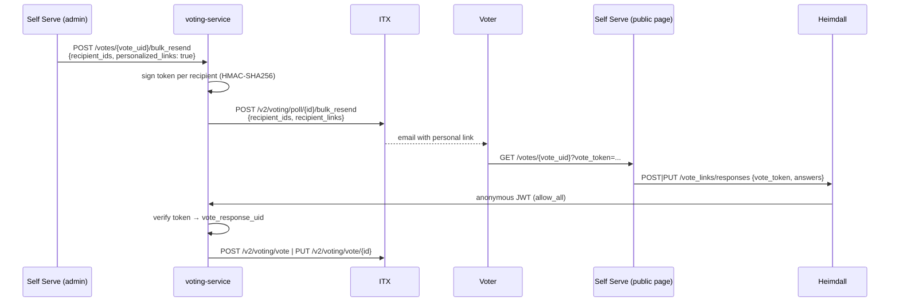

# Personalized Vote Links

A personalized vote link lets one recipient submit or update their vote response without logging in. Callers opt in per bulk resend with `personalized_links: true`. If they don't opt in, every endpoint behaves exactly as it did before.

## Flow



## Link format

```
{LFX_SELF_SERVE_BASE_URL}/votes/{vote_uid}?vote_token={token}
```

Example (production):

```
https://app.lfx.dev/votes/8f3c2a1e-4b5d-4e6f-9a7b-1c2d3e4f5a6b?vote_token=v1.k2026a.eyJ2IjoiOGYzYzJhMWUtNGI1ZC00ZTZmLTlhN2ItMWMyZDNlNGY1YTZiIiwiciI6ImNiYTE0ZjQwLTE2MzYtMTFlYy05NjIxLTAyNDJhYzEzMDAwMiIsImlhdCI6MTc5MzIzMjAwMH0.vY-4FhdIHtowj0UaclJQCHvcT86Fqs47AV_AQMMNKrU
```

## Token format

```
v1.<kid>.<base64url(payload)>.<base64url(HMAC-SHA256(key[kid], "v1.<kid>.<payload>"))>
```

| Part | Meaning |
|---|---|
| `v1` | Format version |
| `kid` | Signing key ID (`[A-Za-z0-9_-]{1,32}`), used for rotation |
| payload | `{"v":"<vote_uid>","r":"<vote_response_uid>","iat":<unix seconds>}` |
| signature | HMAC-SHA256 over the first three segments, compared in constant time |

- **Signed, not encrypted.** Anyone holding the token can decode the payload. It contains only the two IDs, with no email or name.
- **No expiry.** ITX checks on every submission and rejects it once the vote has ended or the voter has been removed. That limits how long a link is useful without needing an expiry in the token.
- **Implementation:** `internal/infrastructure/votelink/hmac_signer.go`, behind `domain.VoteLinkSigner`.

## Authorization model

The `/vote_links/responses` Heimdall rules use the `anonymous_authenticator` and `allow_all` on purpose. Heimdall still issues its JWT (principal `_anonymous`), so the request is proven to have come through the gateway. **The verified token is the only authorization.**

The service enforces this as follows:
- The ballot comes **only** from the token. The request body cannot name a ballot.
- Every invalid token returns the same `404 invalid voting link`, so callers can't learn which check failed or whether a ballot exists.
- ITX enforces the rest on each call:
  - the vote is still active and not past its end time;
  - the voter has not been removed;
  - create needs `vote_status = awaiting_response`;
  - update needs `vote_status = responded`.
- Tokens and links are never logged. Logs record the vote and ballot UIDs and the key ID.

The existing `POST /vote_responses` and `PUT /vote_responses/{id}` routes are unchanged and still require the OpenFGA `owner` check.

## Configuration

| Variable | Description |
|---|---|
| `VOTE_LINK_SIGNING_KEYS` | `kid1:base64key,kid2:base64key`. Each key must be at least 32 bytes after decoding. Unset means the feature is disabled. Set but invalid means the service **fails at startup**. Comes from the `lfx-v2-voting-service-vote-links` Secret (key `VOTE_LINK_SIGNING_KEYS`, optional). That Secret is synced by its own ExternalSecret in lfx-v2-argocd from AWS Secrets Manager `/cloudops/managed-secrets/voting/vote-link-signing-keys` (property `vote_link_signing_keys`), which lfx-secrets-management fills from the 1Password item "LFX Voting Vote Link Signing Keys". |
| `VOTE_LINK_ACTIVE_KID` | The key ID used for signing. Required when more than one key is configured. |
| `LFX_SELF_SERVE_BASE_URL` | The base of the link. Defaults to the environment's LFX app URL, derived from `LFX_ENVIRONMENT`. |

To generate a key: `echo "k$(date +%Y%m):$(openssl rand -base64 32)"`

### Key rotation

1. Add the new key to `VOTE_LINK_SIGNING_KEYS` and set `VOTE_LINK_ACTIVE_KID` to it. Links already sent keep working, because every listed key can verify.
2. Once the old links are no longer needed (for example, after the votes that used them have closed), remove the old key. **Removing a key revokes every link signed with it.** You can use that as an emergency revocation.

## ITX dependency

ITX must accept `recipient_links` on `POST /v2/voting/poll/{poll_id}/bulk_resend` and use each value as that recipient's `VotingLink`. This goes in `itx-service-voting`'s `bulkResendEmail` (`polling.go`), where `models.VotingEmailData.VotingLink` is already set per recipient. ITX should reject:
- keys that aren't in `recipient_ids`;
- links that aren't https on its configured Self Serve host, so a caller can't make ITX email arbitrary URLs.

Until ITX supports this, ITX ignores the field and emails the standard link.

## Known limits

- **A link is a bearer credential.** Anyone who has the email, including a forwarded copy, can vote as that recipient until the vote closes or the voter is removed.
- **Exposure points:**
  - Email security scanners may open the link (GET). That's harmless, because voting needs POST/PUT.
  - SES click tracking and browser history will see the URL.
  - The Self Serve page should send `Referrer-Policy: no-referrer` and redact `vote_token` from its access logs.
- **Only bulk resend sends personalized links.** Enable, extend and reminder emails still use the standard link.
- **No anonymous read endpoint.** The Self Serve page must load the vote's questions itself.
