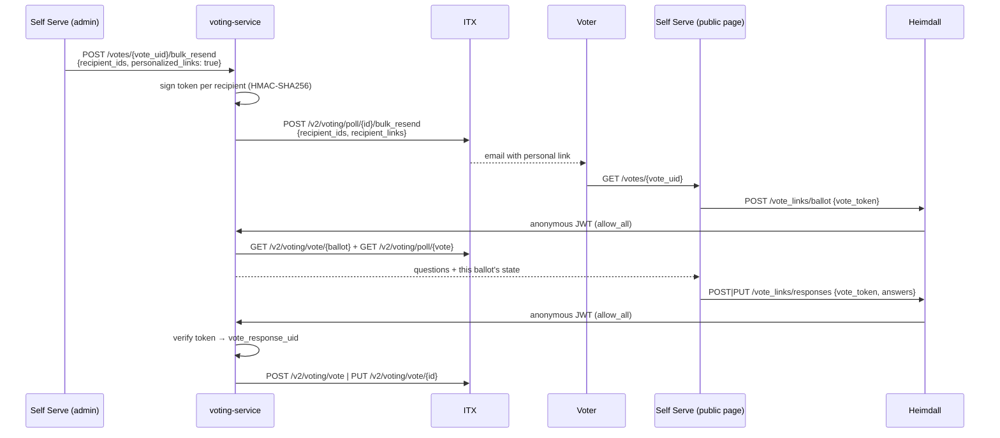

# Personalized Vote Links

A personalized vote link lets one recipient submit or update their vote response without logging in. Callers opt in per bulk resend with `personalized_links: true`. If they don't opt in, every endpoint behaves exactly as it did before.

## Flow



## Link format

```
{LFX_SELF_SERVE_BASE_URL}/votes/{vote_uid}#vote_token={token}
```

The token is in the URL **fragment**, so the browser never sends it to a server. It stays out of access, ingress and CDN logs, OTel `http.url` attributes, `Referer` headers and analytics page events. The Self Serve page reads it client-side and sends it in the body of `POST`/`PUT /vote_links/responses`. `LFX_SELF_SERVE_BASE_URL` must be `https`; the service refuses to start with personalized links enabled otherwise.

Example (production):

```
https://app.lfx.dev/votes/8f3c2a1e-4b5d-4e6f-9a7b-1c2d3e4f5a6b#vote_token=v1.k2026a.eyJ2IjoiOGYzYzJhMWUtNGI1ZC00ZTZmLTlhN2ItMWMyZDNlNGY1YTZiIiwiciI6ImNiYTE0ZjQwLTE2MzYtMTFlYy05NjIxLTAyNDJhYzEzMDAwMiIsImlhdCI6MTc5MzIzMjAwMH0.vY-4FhdIHtowj0UaclJQCHvcT86Fqs47AV_AQMMNKrU
```

## Token format

```
v1.<kid>.<base64url(payload)>.<base64url(HMAC-SHA256(key[kid], "v1.<kid>.<payload>"))>
```

| Part | Meaning |
|---|---|
| `v1` | Format version |
| `kid` | Signing key ID (`[A-Za-z0-9_-]{1,32}`), used for rotation |
| payload | `{"v":"<vote_uid>","r":"<vote_response_uid>","iat":<unix seconds>}` |
| signature | HMAC-SHA256 over the first three segments, compared in constant time |

- **Signed, not encrypted.** Anyone holding the token can decode the payload. It contains only the two IDs, with no email or name.
- **No expiry.** ITX checks on every submission and rejects it while the vote is ended or the voter is removed. Ending a vote does **not** revoke its links permanently: **extending an ended vote reactivates it, and its existing links work again.** Only removing the voter or the signing key revokes a link.
- **Implementation:** `internal/infrastructure/votelink/hmac_signer.go`, behind `domain.VoteLinkSigner`.

## Reading the ballot

`POST /vote_links/ballot { vote_token }` returns what the ballot page needs:

- The vote: name, description, status, end time, poll type, number of winners, whether abstaining is allowed, questions with choices, and comment prompts. It never returns project, committee, creator or response counts.
- This recipient's ballot: `vote_status`, `already_voted` (so the page knows to use `PUT` to change it) and `voter_removed`. On **regular** votes, once a ballot is submitted, it also returns `abstained`, `poll_answers` and `comment_responses`, so the page can prefill them. On **pseudo-anonymous** votes these are never returned, because a forwarded link must not reveal how someone voted.

Both IDs come from the verified token. The service fetches the ballot first and returns `404 invalid voting link` unless it belongs to the token's vote. It then fetches the vote. No ID mapping is involved.

## Authorization model

The `/vote_links/` Heimdall rules (`POST /vote_links/ballot` and `POST`/`PUT /vote_links/responses`) use the `anonymous_authenticator` and `allow_all` on purpose. Heimdall still issues its JWT (principal `_anonymous`), so the request is proven to have come through the gateway. **The verified token is the only authorization.**

The service enforces this as follows:
- The ballot comes **only** from the token. The request body cannot name a ballot.
- Every invalid token returns the same `404 invalid voting link`, so callers can't learn which check failed or whether a ballot exists.
- ITX enforces the rest on each call:
  - the vote is still active and not past its end time;
  - the voter has not been removed;
  - create needs `vote_status = awaiting_response`;
  - update needs `vote_status = responded`.
- Tokens and links are never logged. Logs record the vote and ballot UIDs and the key ID, but not ballot contents such as `abstain`.
- Request bodies on `/vote_links/` are capped at 1 MiB before decoding, and null answer entries are rejected with a 400.

The existing `POST /vote_responses` and `PUT /vote_responses/{id}` routes are unchanged and still require the OpenFGA `owner` check.

## Configuration

| Variable | Description |
|---|---|
| `VOTE_LINK_SIGNING_KEYS` | `kid1:base64key,kid2:base64key`. Each key must be at least 32 bytes after decoding. Unset means the feature is disabled. Set but invalid means the service **fails at startup**. Comes from the `lfx-v2-voting-service` Secret (key `VOTE_LINK_SIGNING_KEYS`, optional), synced by the service's ExternalSecret in lfx-v2-argocd from AWS Secrets Manager `/cloudops/managed-secrets/voting/vote-link-signing-keys` (property `vote_link_signing_keys`), which lfx-secrets-management fills from the 1Password item "LFX Voting Vote Link Signing Keys". |
| `VOTE_LINK_ACTIVE_KID` | Optional override for the signing key ID. When unset, the **first key listed** in `VOTE_LINK_SIGNING_KEYS` signs. Prefer leaving it unset so rotation only touches one Secret value. |
| `LFX_SELF_SERVE_BASE_URL` | The base of the link; must be `https`. Defaults to the environment's LFX app URL, derived from `LFX_ENVIRONMENT`. |

To generate a key: `echo "k$(date +%Y%m):$(openssl rand -base64 32)"`

### Key rotation

Keys are read **only at pod startup**. Creating, rotating or removing a key has no effect on running pods until they restart, so every change below needs a rollout (for example `kubectl rollout restart deployment/lfx-v2-voting-service -n voting-service` after the ExternalSecret has refreshed).

Every replica must be able to verify a new key **before** any replica signs with it. Otherwise a link signed by a new pod could be rejected by an old one during the rollout. So rotate in two steps:

1. **Add the new key last**, e.g. `kOld:...,kNew:...`, and roll out. All replicas now verify `kNew`, and `kOld` still signs.
2. **Move the new key first**, e.g. `kNew:...,kOld:...`, and roll out. `kNew` now signs, and links signed with `kOld` keep working.
3. Once the old links are no longer needed, remove `kOld` and roll out. **Removing a key revokes every link signed with it**, including links for votes that might later be extended.

For an **emergency revocation**, remove the compromised key (adding a fresh key first if the list would be empty) and roll out immediately.

## ITX dependency

ITX must accept `recipient_links` on `POST /v2/voting/poll/{poll_id}/bulk_resend` and use each value as that recipient's `VotingLink`. This goes in `itx-service-voting`'s `bulkResendEmail` (`polling.go`), where `models.VotingEmailData.VotingLink` is already set per recipient. ITX should reject:
- keys that aren't in `recipient_ids`;
- links that aren't `https://<Self Serve host>/votes/{poll_id}#vote_token=...`, so a caller can't make ITX email arbitrary URLs.

Until ITX supports this, ITX ignores the field and emails the standard link.

## Known limits

- **A link is a bearer credential.** Anyone who has the email, including a forwarded copy, can vote as that recipient while the vote is active, including after an ended vote is extended, until the voter or the signing key is removed.
- **Exposure points:**
  - Email security scanners may open the link (GET). That's harmless, because voting needs POST/PUT.
  - SES click tracking and browser history will see the full URL, fragment included.
  - Servers, `Referer` headers and request logs never see the token, because it's in the fragment.
- **Only bulk resend sends personalized links.** Enable, extend and reminder emails still use the standard link.
- **Prefill depends on the vote type.** A link holder can read their own previous answers on regular votes, but not on pseudo-anonymous ones.
